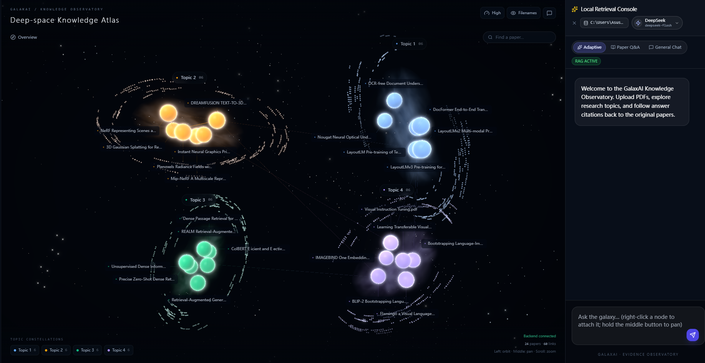
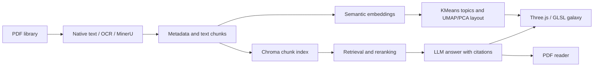

# PDF_GalaxAI

### Semantic Literature Galaxy & RAG Workspace

[Chinese version](README.zh-CN.md) · [User guide (Chinese)](docs/USER_GUIDE.md) · [Graphics methods (Chinese)](GRAPHICS_RESEARCH.md)

PDF_GalaxAI turns a PDF library into an interactive three-dimensional knowledge space. Each document becomes a luminous single-color sphere with a surface-adjacent, exponentially fading halo. Semantic topic clusters form flowing dust ribbons, surrounded by orbiting star bands and an independent drifting background star field. Weighted similarity links reveal relationships between papers.

The project combines real-time computer graphics with document processing and retrieval-augmented generation (RAG). Users can explore topics spatially, select evidence papers, and continue reading or asking questions with citations back to the original PDF.

This repository contains a locally run web application. The full application uses a browser frontend and a Python backend. Install the dependencies and configure a model using the instructions below after downloading the source.

[Interface overview](#interface-overview) · [Features](#what-you-can-do) · [Download](#download-the-project) · [Requirements](#requirements) · [Graphics demo](#try-the-graphics-demo) · [Full setup](#full-setup) · [Troubleshooting](#troubleshooting)

## Interface overview



Current interface, captured on October 12, 2026 with a local collection of 24 PDFs, four topic clusters and 60 semantic links. The screenshot shows luminous paper nodes, flowing cloud structures, peripheral star bands, scattered background stars and the backend connection indicator. This document collection is not included in the source download.

The main workspace places the semantic knowledge galaxy beside the retrieval and chat console. Topic-grouped paper nodes and similarity links support collection exploration, while the console provides contextual questions and a visible model choice. Selecting a paper connects this overview to paper details and PDF reading.

## What you can do

| Feature | What it helps you do |
| --- | --- |
| PDF library and processing | Upload or batch-import documents, extract text and metadata, and maintain a local vector index. Optional OCR and MinerU support difficult PDFs. |
| 3D semantic knowledge galaxy | Explore luminous paper nodes, data-oriented clouds, orbiting star bands and independently drifting background stars; move between overview, topic and paper close-ups. |
| Contextual AI questions | Attach a paper to a question and choose Adaptive, Paper Q&A or General Chat mode. Use Ollama, Gemini or an OpenAI-compatible provider. |
| Source evidence | Real returned citations progressively illuminate their planets and remain highlighted. Click a source to fly to its planet, then open the original passage. |
| PDF reading | Open a paper in the reader, ask questions about it and highlight candidate source text. Image-capable models also accept questions about screenshots of formulas or figures. |
| Interface controls | Switch languages and quality, search filenames, toggle full/compact labels, and fold the Q&A panel for an unobstructed view. |

The galaxy combines custom GLSL volume rendering, GPU particle animation, self-emissive sphere shading and HDR Bloom. Surface-adjacent halos fade in brightness, opacity and saturation toward their outer edge; breathing changes the glow field rather than scaling the sphere. Topic star bands orbit their clouds, while a separate background population gently drifts and twinkles without attraction to any cluster. Cloud orientation follows the paper distribution, and decorative animation does not move document coordinates. These are artistic rendering effects, not a gravitational simulation or a measure of scientific quality. See [graphics methods](GRAPHICS_RESEARCH.md) and [redesign notes](docs/NEBULA_REDESIGN.md).

## Download the project

Choose either method. Git is needed only for cloning.

**Download without Git**

1. Open the [GitHub repository](https://github.com/zhD1dqz/PDF_GalaxAI).
2. Select **Code → Download ZIP** and extract the archive.
3. Open a terminal in the extracted project directory containing `package.json`, `frontend/` and `backend/`. Run the commands below from that directory.

**Clone with Git**

```bash
git clone https://github.com/zhD1dqz/PDF_GalaxAI.git
cd PDF_GalaxAI
```

The source download excludes user PDFs, installed dependencies, model weights, local configuration and vector databases. Prepare your own PDFs and install the dependencies after downloading.

## Requirements

| Requirement | Graphics demo | Full PDF / RAG application |
| --- | --- | --- |
| Node.js and npm | Required: Node.js 20.19+ or 22.12+ | Required: same version range |
| WebGL-capable browser | Required | Required |
| Python | Not required | Python 3.11+; 3.11 or 3.12 is recommended for initial setup |
| Embedding model | Not required | Required for neural semantic retrieval; downloaded on first use or supplied locally |
| User PDF files | Not required; uses synthetic nodes | Required to build a real document collection |
| Question-answering model | Not required | A running Ollama model or a configured cloud/API provider is required for AI answers |
| Tesseract / MinerU | Not required | Optional; install separately when needed for OCR or advanced parsing |

Download Node.js from [nodejs.org](https://nodejs.org/en/download), Python from [python.org](https://www.python.org/downloads/), and Ollama, if using local Q&A, from [ollama.com](https://ollama.com/download). Ensure the installed commands are available in a new terminal. On Windows, enable Python's **Add to PATH** option during installation.

Check your environment before continuing:

```bash
node --version
npm --version
```

For the full application, also run `python --version` on Windows or `python3 --version` on macOS/Linux. Internet access is needed to install dependencies and download models unless they are already available locally. Cloud Q&A needs network access and your own provider credentials. Available memory and model size affect local inference performance; no fixed hardware performance guarantee is provided.

**Choose a starting point:** use the graphics demo to inspect the visualization with minimal setup, or complete the full setup to upload real PDFs, read them and use RAG.

## Try the graphics demo

The graphics demo uses 44 deterministic sample nodes across four topics. It requires only the frontend, with no PDFs, backend or API keys.

```bash
npm ci
npm run demo
```

Open `http://localhost:3000/?graphicsDemo=1` if the browser does not open automatically. If the complete application is already running, use that URL without starting another frontend. The Windows `PDF_GalaxAI.cmd` launcher opens the full application and real document library, not this synthetic demo.

Demo nodes are synthetic visual examples. Reading real PDFs and using RAG require the full setup below.

## Full setup

### 1. Install dependencies

Run these commands in the project directory. The Python virtual environment keeps backend dependencies separate from other projects. These commands use its Python executable directly, so activating the environment is unnecessary.

**Windows PowerShell**

```powershell
python -m venv .venv
.\.venv\Scripts\python.exe -m pip install --upgrade pip
.\.venv\Scripts\python.exe -m pip install -r backend\requirements.txt
npm ci
Copy-Item backend\.env.example backend\.env
```

**macOS / Linux**

```bash
python3 -m venv .venv
.venv/bin/python -m pip install --upgrade pip
.venv/bin/python -m pip install -r backend/requirements.txt
npm ci
cp backend/.env.example backend/.env
```

Copy the environment template only on first setup, then edit `backend/.env`. Keep the default template values to start with the lightweight embedding model and local Ollama Q&A.

### 2. Configure models

The template selects the lightweight `sentence-transformers/all-MiniLM-L6-v2` embedding model and four topic clusters. For a larger multilingual model, set `SCHOLAR_ST_MODEL=BAAI/bge-m3`.

**Choose one Q&A option.** You do not need to configure every provider.

**Local Ollama:** install and start Ollama, then download the model named in `SCHOLAR_OLLAMA_MODEL`:

```bash
ollama pull qwen2.5:3b
ollama run qwen2.5:3b
```

Confirm it can answer a simple question, then exit the interactive chat while leaving the Ollama service running. The template uses `SCHOLAR_LLM_PROVIDER=local` and `SCHOLAR_OLLAMA_MODEL=qwen2.5:3b`.

**Cloud Gemini:** set `SCHOLAR_LLM_PROVIDER=gemini` and enter your own `GEMINI_API_KEY` in `backend/.env`. Use a model available to your account via `SCHOLAR_GEMINI_MODEL`, then restart the backend.

**OpenAI-compatible API:** start the application, open the model manager, add the provider's base URL, model ID and API key, test the connection and select the model for Q&A. Keep actual credentials in local configuration.

An embedding model and a Q&A model serve different purposes: the embedding model finds related papers and passages; the Q&A model generates the answer. Configuring a cloud Q&A provider does not remove the embedding model requirement. Initial model downloads and PDF indexing can take time; inspect the backend log while they run.

### 3. Start both services

**Windows, terminal A**

```powershell
.\.venv\Scripts\python.exe -m uvicorn main:app --app-dir backend --host 127.0.0.1 --port 8000
```

**macOS / Linux, terminal A**

```bash
.venv/bin/python -m uvicorn main:app --app-dir backend --host 127.0.0.1 --port 8000
```

**Terminal B**

Open a second terminal in the same project directory and keep terminal A running.

```bash
npm run dev
```

Open `http://localhost:3000/`, or use the address printed by Vite if it chooses another available port. Check `http://127.0.0.1:8000/api/health` to confirm that the backend responds. API documentation is available at `http://127.0.0.1:8000/docs`.

After installing dependencies, Windows users can double-click `PDF_GalaxAI.cmd`. It prefers the project virtual environment, starts the backend, waits for readiness, starts/reuses the frontend, verifies its API proxy, and opens the real library. Repeated launches reuse this project's services; unrelated occupied ports are reported without stopping other processes. Logs are kept under `logs/`.

### 4. Check your first document workflow

1. Upload one or two PDFs with readable text and wait for processing to finish. A new installation starts with an empty library.
2. Rotate the galaxy and select a paper node to inspect its details.
3. Attach the paper to the conversation, select your configured model and choose **Paper Q&A**. Ask a question whose answer should appear in that paper.
4. Review retrieved source snippets and follow a citation into the PDF reader. Page matching is heuristic, so check the original text yourself.
5. If the application reports an embedding-model mismatch, rebuild the vector index using the interface control. New uploads normally use incremental indexing.

For the manual two-terminal setup, press **Ctrl+C** in each terminal. Launcher-created services run in the background; closing the launcher does not stop them. Their specific PIDs are recorded in `logs/launcher-processes.json` for inspection in Task Manager. Reused manually started services still belong to their original terminal. PDFs and indexes remain in `backend/data/`.

### Optional parsing tools

Readable text PDFs use native extraction without extra executables. Scanned PDFs may need Tesseract and the relevant language packs; installing the Python package alone does not install the OCR engine. MinerU is also installed separately. Configure `SCHOLAR_TESSERACT_CMD` or `SCHOLAR_MINERU_CMD` if the executable is not discoverable. See the [OCR and MinerU instructions](docs/USER_GUIDE.md) for details. Python 3.13+ uses PCA because the project disables UMAP on those versions.

### Deployment scope

These instructions run the application on your own computer. GitHub hosts the source and documentation; uploading the folder does not start the application. `npm run build` creates the frontend in `dist/`, while PDF processing and RAG still require the FastAPI backend and model configuration. A public hosted service needs a separate backend deployment and access-control setup, which this local setup guide does not provide.

## Using the galaxy

| Action | Control |
| --- | --- |
| Rotate the view | Left mouse drag |
| Pan the view | Middle mouse drag |
| Zoom | Mouse wheel |
| Open a paper's details | Left click a planet |
| Attach a paper to the conversation | Right click a planet |
| Locate a paper | Filename search |
| Change rendering cost | Low / High quality toggle |
| Change interface language | Chinese / English selector |
| Explore a topic | Click a floating topic label or a bottom topic chip |
| Return to a wider view | Overview/topic breadcrumbs or the back arrow |
| Control filenames | All filenames / Compact toggle; full filenames remain available in tooltips |
| Expand the canvas | Fold the Q&A console with the speech-bubble button |
| Follow an answer's source | Click a citation: camera arrival precedes opening the PDF |

Upload through the interface, or place named PDFs in `backend/data/files/` or `backend/data/inbox/` before starting the backend. Named source PDFs in `files` remain in place. Imported `inbox` files move into `inbox/_processed/`.

The backend creates missing data directories automatically. File fingerprints prevent repeated imports during later scans.

## Architecture



| Layer | Main technologies |
| --- | --- |
| Interface | React, TypeScript, Vite, Tailwind CSS |
| Graphics | Three.js, React Three Fiber, GLSL volume rendering and GPU star fields, HDR Bloom |
| Document processing | FastAPI, PyMuPDF, optional Tesseract and MinerU |
| Semantic analysis | Sentence Transformers, KMeans, UMAP/PCA, TF-IDF fallback |
| Retrieval and Q&A | Chroma, hybrid reranking, Ollama, Gemini, OpenAI-compatible APIs |

## Configuration and recovery

| Setting | Purpose |
| --- | --- |
| `SCHOLAR_ST_MODEL` | Embedding model ID or local checkpoint directory |
| `SCHOLAR_OFFLINE` | Use cached/local model files only when set to `1` |
| `SCHOLAR_CLUSTER_COUNT` | Requested topic count, or `auto` for silhouette selection |
| `SCHOLAR_OCR_ENABLED` | `auto`, `force` or `off` |
| `SCHOLAR_LLM_PROVIDER` | Default Q&A provider |
| `GEMINI_API_KEY` | Optional Gemini credentials |

After changing embedding models, restart the backend and rebuild the vector index in the interface. Neural model failures fall back to TF-IDF for the galaxy layout, but full-text semantic RAG still requires a working embedding model.

If a legacy library has missing sources or overlapping coordinates, stop the backend and run:

```bash
python backend/recover_library.py --archive-missing
```

The recovery script imports local PDFs, recomputes the layout and preserves unavailable old records under `backend/data/backups/`. Restart both services afterward.

## Troubleshooting

| Symptom | What to check |
| --- | --- |
| `node`, `npm`, `python` or `python3` is not found | Install the required runtime, check PATH and open a new terminal. Use the correct Python command for your platform. |
| Python reports a missing module | Install `backend/requirements.txt` with the same `.venv` Python executable used to start the backend. |
| The page reports that the backend is unavailable | For manual startup, keep terminal A running; for the Windows launcher, inspect `logs/`. Check `http://127.0.0.1:8000/api/health` and the canvas connection indicator. The Vite proxy expects the backend on port 8000. |
| The launcher reports an occupied port | Identify the program using port 3000 or 8000 and resolve the conflict yourself. The launcher reuses this project's services but does not stop unrelated programs. |
| The galaxy is empty after startup | Upload your own PDFs. Downloaded source does not include the screenshot's document collection. For synthetic examples, use `npm run demo`. |
| The first startup or upload appears slow | Check the backend log for embedding-model downloads or PDF processing. Model weights are not bundled with the source. |
| Q&A fails or has no source evidence | Verify the selected provider's connection and model availability. Upload relevant PDFs and resolve any embedding-index warning. General Chat mode does not retrieve document evidence. |
| Cloud requests fail | Check the API key, base URL, model ID and network/proxy settings in the model manager; use its connection test. |
| PDF text is unreadable or missing | Check the PDF's text layer. Install Tesseract with the required languages for OCR, or configure the optional MinerU parser. |
| The galaxy renders slowly | Select the lower graphics quality mode and use a WebGL-capable browser. Larger libraries and local models impose greater rendering or inference costs. |

Keep your local configuration and data outside commits: `backend/.env`, user PDFs, model weights and generated vector databases are excluded from the source archive. Files and vectors remain local; cloud inference sends the selected context and any submitted image to the configured provider.

For further diagnosis, retain the backend error log and browser-console error. See the [detailed user guide](docs/USER_GUIDE.md).

## Development

```bash
npm run typecheck
npm run test:graphics
npm run test:launcher
npm run build
python tests/test_layout_recovery.py
```

The regression checks cover graphics data and layout logic, halo falloff, independent star drift, launcher readiness and service reuse, model path resolution, import deduplication and configurable topic counts. They do not require downloaded model weights or user PDFs. Logic checks do not replace browser shader compilation, visual review or GPU performance benchmarks.

`tests/verify_live_library.py` is an optional integration check for the local 24-PDF test library, with both services running. See [test data](docs/TEST_DATA.md).

To create a clean source archive:

```bash
python scripts/package_github.py
```

The archive appears in `release/`. See [GitHub upload instructions](docs/GITHUB_UPLOAD.md).

## Repository structure

```text
frontend/src/rendering/    GLSL nebulae, glowing planets, two star layers and demo data
frontend/src/ui/           Galaxy interaction, PDF reader and chat
frontend/src/api/          Backend client
backend/                  PDF processing, semantic layout, indexing and APIs
backend/.env.example      Public configuration template
tests/                    Regression and local integration checks
scripts/                  Full-application launcher and source packaging
docs/                     Usage, interface screenshot, test data and upload instructions
```

## Scope and limitations

This is a working visualization and RAG prototype. Volumetric clouds, glow and decorative star motion are artistic approximations, not physical simulations. Pure-color planets use topic colors and stable per-document animation parameters; their appearance does not encode a paper's scientific quality. Background stars are decorative and do not represent additional documents.

Topic labels and three-dimensional distances approximate semantic relationships. A fixed cluster count sets the desired level of detail rather than proving an intrinsic number of topics. RAG answers need checking against their cited sources. Formal user studies and large-scale rendering benchmarks remain future work.

User PDFs, vector databases, model weights, browser profiles and credentials are excluded from version control and the source archive. Download embedding models and prepare your own PDFs after cloning.

Detailed operating instructions: [Chinese user guide](docs/USER_GUIDE.md). Rendering methods and proposed evaluation: [graphics research notes](GRAPHICS_RESEARCH.md).
