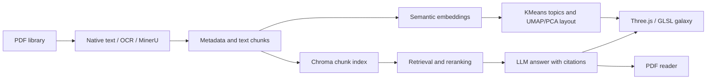

# PDF_GalaxAI

### Semantic Literature Galaxy & RAG Workspace

[简体中文](README.zh-CN.md) · [User guide](docs/USER_GUIDE.md) · [Graphics methods](GRAPHICS_RESEARCH.md)

PDF_GalaxAI turns a PDF library into an interactive three-dimensional knowledge space. Each document becomes a rotating, procedurally shaded planet. Semantic topic clusters form animated volumetric nebulae, while similarity links reveal relationships between papers.

The project combines real-time computer graphics with document processing and retrieval-augmented generation (RAG). Users can explore topics spatially, select evidence papers, and continue reading or asking questions with citations back to the original PDF.

## Highlights

- **Semantic visual encoding.** KMeans topic clusters control nebula colors. UMAP/PCA coordinates drive spatial layout, followed by cluster separation and collision correction. Similarity to a cluster centroid controls planet size.
- **Custom GLSL rendering.** Object-space ray marching samples an animated FBM density field. Quality modes use up to 28 or 46 volume samples per pixel.
- **GPU particle animation.** A single `THREE.Points` system updates particle motion and brightness in vertex shaders, without per-particle JavaScript updates each frame.
- **Procedural planets.** Stable document fingerprints vary lunar surface details, axial tilt and rotation. A continuous radial glow fades in brightness, opacity and saturation away from each planet.
- **Evidence-linked reading.** RAG retrieval highlights relevant planets and returns citations that can open the corresponding PDF page. Screenshot questions support formulas and figures when the selected LLM accepts images.
- **Local PDF workflow.** Upload, batch import, OCR, optional MinerU parsing, persistent Chroma indexing, Chinese/English UI and configurable LLM providers.

## Try the graphics demo

The graphics demo uses 44 deterministic sample nodes across four topics. It requires only the frontend, with no PDFs, backend or API keys.

```bash
npm ci
npm run demo
```

Open `http://localhost:3000/?graphicsDemo=1` if the browser does not open automatically. On Windows, `GRAPHICS_DEMO.cmd` starts the same demo.

Demo nodes are synthetic visual examples. Reading real PDFs and using RAG require the full setup below.

## Full setup

### Requirements

- Node.js 20.19+ or 22.12+
- Python 3.11+ and a browser with WebGL support
- An embedding model, downloaded on first use or supplied as a local directory
- For Q&A: a running Ollama model or a configured cloud/API model

Tesseract and MinerU are optional external tools. Python 3.13+ uses PCA because this project disables UMAP on those versions.

### 1. Install dependencies

Run these commands in the project directory.

**Windows PowerShell**

```powershell
python -m venv .venv
.\.venv\Scripts\python.exe -m pip install -r backend\requirements.txt
npm ci
Copy-Item backend\.env.example backend\.env
```

**macOS / Linux**

```bash
python3 -m venv .venv
.venv/bin/python -m pip install -r backend/requirements.txt
npm ci
cp backend/.env.example backend/.env
```

Copy the environment template only on first setup, then edit `backend/.env`.

### 2. Configure models

The template selects the lightweight `sentence-transformers/all-MiniLM-L6-v2` embedding model and four topic clusters. For a larger multilingual model, set `SCHOLAR_ST_MODEL=BAAI/bge-m3`.

For local Q&A, prepare the model named in `SCHOLAR_OLLAMA_MODEL`:

```bash
ollama pull qwen2.5:3b
```

Alternatively, configure Gemini in `backend/.env`, or add an OpenAI-compatible provider in the application's model manager. Keep actual credentials in local configuration.

### 3. Start both services

**Windows, terminal A**

```powershell
.\.venv\Scripts\python.exe -m uvicorn main:app --app-dir backend --host 127.0.0.1 --port 8000
```

**macOS / Linux, terminal A**

```bash
.venv/bin/python -m uvicorn main:app --app-dir backend --host 127.0.0.1 --port 8000
```

**Terminal B**

```bash
npm run dev
```

Open `http://localhost:3000/`. Health check: `http://127.0.0.1:8000/api/health`.

After installing dependencies, Windows users can also double-click `PDF_GalaxAI.cmd`. It uses the project virtual environment when available. Initial imports and model downloads may take longer than the launcher delay.

## Using the galaxy

| Action | Control |
| --- | --- |
| Rotate the view | Left mouse drag |
| Pan the view | Middle mouse drag |
| Zoom | Mouse wheel |
| Open a paper's details | Left click a planet |
| Attach a paper to the conversation | Right click a planet |
| Locate a paper | Filename search |
| Change rendering cost | Low / High quality toggle |
| Change interface language | Chinese / English selector |

Upload through the interface, or place named PDFs in `backend/data/files/` or `backend/data/inbox/` before starting the backend. Named source PDFs in `files` remain in place. Imported `inbox` files move into `inbox/_processed/`.

The backend creates missing data directories automatically. File fingerprints prevent repeated imports during later scans.

## Architecture



| Layer | Main technologies |
| --- | --- |
| Interface | React, TypeScript, Vite, Tailwind CSS |
| Graphics | Three.js, React Three Fiber, custom GLSL, Bloom |
| Document processing | FastAPI, PyMuPDF, optional Tesseract and MinerU |
| Semantic analysis | Sentence Transformers, KMeans, UMAP/PCA, TF-IDF fallback |
| Retrieval and Q&A | Chroma, hybrid reranking, Ollama, Gemini, OpenAI-compatible APIs |

## Configuration and recovery

| Setting | Purpose |
| --- | --- |
| `SCHOLAR_ST_MODEL` | Embedding model ID or local checkpoint directory |
| `SCHOLAR_OFFLINE` | Use cached/local model files only when set to `1` |
| `SCHOLAR_CLUSTER_COUNT` | Requested topic count, or `auto` for silhouette selection |
| `SCHOLAR_OCR_ENABLED` | `auto`, `force` or `off` |
| `SCHOLAR_LLM_PROVIDER` | Default Q&A provider |
| `GEMINI_API_KEY` | Optional Gemini credentials |

After changing embedding models, restart the backend and rebuild the vector index in the interface. Neural model failures fall back to TF-IDF for the galaxy layout, but full-text semantic RAG still requires a working embedding model.

If a legacy library has missing sources or overlapping coordinates, stop the backend and run:

```bash
python backend/recover_library.py --archive-missing
```

The recovery script imports local PDFs, recomputes the layout and preserves unavailable old records under `backend/data/backups/`. Restart both services afterward.

## Development

```bash
npm run typecheck
npm run build
python tests/test_layout_recovery.py
```

The regression suite covers model path resolution, import deduplication, fallback layouts, node separation and configurable topic counts. It does not require downloaded model weights or user PDFs.

`tests/verify_live_library.py` is an optional integration check for the local 24-PDF test library, with both services running. See [test data](docs/TEST_DATA.md).

To create a clean source archive:

```bash
python scripts/package_github.py
```

The archive appears in `release/`. See [GitHub upload instructions](docs/GITHUB_UPLOAD.md).

## Repository structure

```text
frontend/src/rendering/    GLSL nebulae, particles, planets and demo data
frontend/src/ui/           Galaxy interaction, PDF reader and chat
frontend/src/api/          Backend client
backend/                  PDF processing, semantic layout, indexing and APIs
backend/.env.example      Public configuration template
tests/                    Regression and local integration checks
scripts/                  Source packaging
docs/                     Usage, test data and GitHub upload instructions
```

## Scope and limitations

This is a working visualization and RAG prototype. The volumetric nebula and glow shaders are artistic approximations. Planet appearance includes stable identity variation, and does not encode a paper's scientific quality.

Topic labels and three-dimensional distances approximate semantic relationships. A fixed cluster count sets the desired level of detail rather than proving an intrinsic number of topics. RAG answers need checking against their cited sources. Formal user studies and large-scale rendering benchmarks remain future work.

User PDFs, vector databases, model weights, browser profiles and credentials are excluded from version control and the source archive. Download embedding models and prepare your own PDFs after cloning.

Detailed operating instructions: [Chinese user guide](docs/USER_GUIDE.md). Rendering methods and proposed evaluation: [graphics research notes](GRAPHICS_RESEARCH.md).
